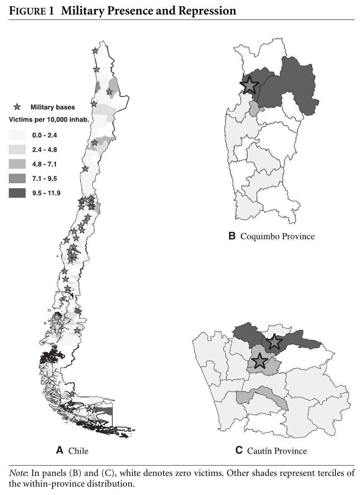
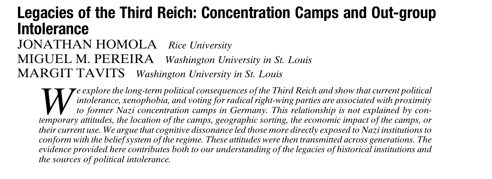
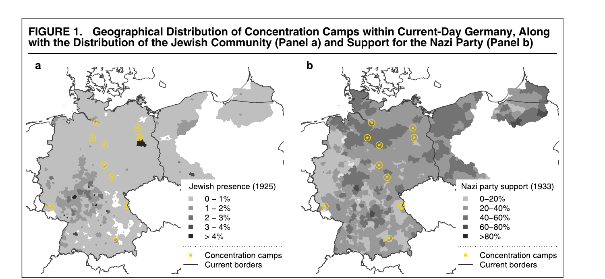

## Objetivos de la ayudantía
```{=html}
<style>
.reveal .slides {
  font-size: 0.85em;
}
.reveal pre {
  font-size: 0.6em !important;
}
.reveal .slides section.smaller pre {
  font-size: 0.75em !important;
}
.reveal .slides section.smaller pre.sourceCode {
  font-size: 0.9em !important;    /* código */
}
.reveal .slides section.smaller .cell-output pre {
  font-size: 0.75em !important;   /* resultados de R */
}
</style>
```


```{r}
#| label: setup-fuentes
#| include: false
setwd("~/OneDrive - Universidad Católica de Chile/Nacho UC/Sociología UC (2021-2024)/Magíster 2025/Ayudantías 12vo Semestre/Modelos de Regresión/ayudantias/ayudantia3")
library(systemfonts)
library(sysfonts)

sysfonts::font_add(
  family  = "Gill Sans MT",
  regular = "GIL_____.TTF",
  bold    = "GILB____.TTF",
  italic  = "GILI____.TTF"
)
showtext::showtext_auto()
```

- Entender la idea general del paper con el que trabajarán en el Ejercicio 1
- Preparar la base: **filtro** y **ponderador**
- Aplicar regresiones, valores predichos y test F con otro paper
- Reportar resultados en **tablas de calidad** en Word

------------------------------------------------------------------------

## El paper en una lámina {.small}

::: {.columns}
::: {.column width="58%"}
::: fragment
- **Pregunta:** la represión de una dictadura, ¿silencia a la oposición o la fortalece?
- **Caso:** dictadura de Pinochet (1973-1990) y plebiscito de 1988
- **Unidad de análisis:** la **comuna**
:::

::: fragment
Hoy aplicaremos algunos contenidos de @bautista2023: cómo preparar la base para trabajar con sus datos.
:::

::: fragment
**Referencia:** @bautista2023. The geography of repression and opposition to autocracy. *American Journal of Political Science, 67*(1), 101-118. <https://doi.org/10.1111/ajps.12614>
:::
:::

::: {.column width="42%"}
{height="560"}
:::
:::

------------------------------------------------------------------------

## Al leer el paper, pregúntense... {.small}

::: fragment
- ¿Qué efectos **podría** tener la represión sobre la participación política? ¿Por qué podría **aumentar** la oposición en vez de reducirla?
:::

::: fragment
- ¿La represión fue **aleatoria**? ¿A quiénes se dirigió? ¿Qué problema genera eso si solo comparamos comunas con más y menos víctimas?
:::

::: fragment
- ¿Qué significa estar **expuesto** a la represión? ¿Por qué los autores se fijan en dónde estaban las bases militares **antes** del golpe?
:::

::: fragment
- ¿Cómo se midió cada variable del enunciado y **por qué** de esa forma?
:::

::: fragment
**Sugerencia:** lean con el enunciado al lado y anoten dónde aparece cada variable en el texto.
:::

------------------------------------------------------------------------

## Cargar la base y filtrar {.smaller}

::: fragment
```{r}
#| eval: true
options(scipen = 999)
library(foreign)   # Para leer bases de Stata: read.dta()

data <- read.dta("FinalDatasetForReplicationStata12.dta")
dim(data)
table(data$MainSample)
```
:::

::: fragment
**¿Por qué filtrar?** Los autores excluyen comunas con valores extremos de represión y con datos faltantes:

> "After dropping a dozen outliers and counties with missing data, our estimating sample includes 276 counties" [@bautista2023, p. 106].
:::

::: fragment
```{r}
#| eval: true
data2 <- data[data$MainSample == 1, ]   # R base: [filas, columnas]
dim(data2)
```
:::

------------------------------------------------------------------------

## El ponderador: ¿por qué? {.smaller}

::: fragment
```{r}
#| eval: true
summary(data2$Pop70)
```
:::

::: fragment
- Sin ponderar, cada **comuna** pesa lo mismo: una de 339 habitantes cuenta igual que una de 321.250
- Pero registrarse es una conducta **individual**:

> "we weight our estimates by population in 1970. This way we ensure that we give equal importance to all voters, irrespective of the size of the county in which they reside" [@bautista2023, p. 109].
:::

::: fragment
**Ojo:** `Pop70` (personas) es el **ponderador**. `Pop70_pthousands` (cientos de miles) es un **control**.
:::

------------------------------------------------------------------------

## Promedio simple vs. ponderado {.smaller}

::: fragment
```{r}
#| eval: true
mean(data2$Share_reg70_w2)                                   # Cada comuna pesa 1
sum(data2$Pop70 * data2$Share_reg70_w2) / sum(data2$Pop70)   # A mano
weighted.mean(data2$Share_reg70_w2, w = data2$Pop70)         # R base
```
:::

::: fragment
El promedio ponderado (**71,16**) coincide con el que reportan los autores: ellos también ponderan.
:::

::: fragment
Si no ponderan, sus números **no van a cuadrar** con los del paper.
:::

------------------------------------------------------------------------

## Ponderar en `lm()` {.smaller}

::: fragment
Un modelo solo con intercepto estima el promedio de $Y$. Con `weights`, estima el promedio **ponderado**:

```{r}
#| eval: true
coef(lm(Share_reg70_w2 ~ 1, data = data2))
coef(lm(Share_reg70_w2 ~ 1, data = data2, weights = Pop70))
```
:::

::: fragment
Con `weights`, `lm()` estima por **Mínimos Cuadrados Ponderados**: minimiza $\sum_i w_i (y_i - \hat{y}_i)^2$.
:::

::: fragment
```{r}
#| eval: false
lm(Y ~ X + controles, data = data2, weights = Pop70)
```
:::

------------------------------------------------------------------------

## Legacies of the Third Reich {.small}

::: fragment
Ahora aplicamos lo que necesitan para el ejercicio con @homola2020:
:::

::: fragment
{fig-align="center" width="85%"}
:::

::: fragment
**Referencia:** @homola2020. Legacies of the Third Reich: Concentration camps and out-group intolerance. *American Political Science Review, 114*(2), 573-590. <https://doi.org/10.1017/S0003055419000832>
:::

------------------------------------------------------------------------

## El argumento {.small}

::: fragment
- Los campos eran sobre todo **campos de trabajo**, conectados con las comunidades vecinas
- Quienes vivían cerca estuvieron más **expuestos**: la **disonancia cognitiva** los llevó a adoptar las creencias del régimen
:::

::: fragment
- Esas actitudes se **transmitieron entre generaciones**: hoy explican la intolerancia, el resentimiento y el voto por la extrema derecha
:::

::: fragment
- Los campos se ubicaron por **razones económicas** (canteras, minas, industrias)
:::


::: fragment
{fig-align="center" width="70%"}
:::


------------------------------------------------------------------------

## Datos y variables {.smaller}

::: fragment
```{r}
#| eval: true
library(texreg)   # Tablas de regresión: screenreg(), htmlreg()
library(car)      # linearHypothesis()

evs <- read.csv("EVS_main.csv")
dim(evs)          # Encuesta EVS 2008: la unidad es la persona
```
:::

::: fragment
- **`intolerance`**: intolerancia hacia exogrupos (no querer como vecinos a personas de otra raza, musulmanes, judíos, inmigrantes, homosexuales y gitanos). Mayor puntaje = más intolerancia
- **`Distance`**: distancia al campo de concentración más cercano, en **decenas de km**
- **Controles** (medidos a nivel de distrito, antes de los campos):
  - `unemployment33`: desempleo en 1933
  - `nazishare33`: votación nazi en 1933
  - `population25`: población en 1925
  - `prop_jewish25`: proporción judía en 1925
:::

------------------------------------------------------------------------

## El modelo teórico {.small}

::: fragment
$$\texttt{intolerance}_i = \beta_0 + \beta_1 \texttt{Distance}_i + u_i$$
:::

::: fragment
- $\beta_1$: cambio esperado en la intolerancia por cada **10 km** adicionales de distancia al campo
- Hipótesis de los autores: $\beta_1 < 0$
:::

::: fragment
**Supuesto: media condicional cero**, $E(u \mid \texttt{Distance}) = 0$
:::

::: fragment
¿Es creíble? Si las condiciones económicas que explican dónde se ubicaron los campos también afectan la intolerancia, están en $u$ **y** se asocian con la distancia → **sesgo**.
:::

------------------------------------------------------------------------

## Intolerancia sobre distancia {.smaller}

```{r}
#| eval: true
m1 <- lm(intolerance ~ Distance, data = evs)
m2 <- lm(intolerance ~ Distance +
           unemployment33 + nazishare33 + population25 + prop_jewish25,
         data = evs)
screenreg(l = list(m1, m2), stars = c(0.01, 0.05), digits = 3,
          single.row = TRUE)   # Coeficiente y EE en la misma fila
```

::: fragment
**Modelo 1:** por cada 10 km adicionales de distancia al campo más cercano, la intolerancia **disminuye en 0,009 puntos**. Es significativo al 1% ($p < 0,01$): rechazamos $H_0: \beta_1 = 0$.
:::

::: fragment
**Modelo 2:** controlando por las covariables, la intolerancia **disminuye en 0,011 puntos** por cada 10 km ($p < 0,01$).
:::

------------------------------------------------------------------------

## Intolerancia sobre desempleo en 1933 {.smaller}

::: fragment
**Sin** la distancia como control:

```{r}
#| eval: true
m3 <- lm(intolerance ~ unemployment33, data = evs)
m4 <- lm(intolerance ~ unemployment33 +
           nazishare33 + population25 + prop_jewish25, data = evs)
screenreg(l = list(m3, m4), stars = c(0.01, 0.05), digits = 3)
```
:::

::: fragment
El desempleo está en **proporción** (0 a 1): interpretamos por **10 puntos porcentuales**, es decir, multiplicamos el coeficiente por 0,1.
:::

::: fragment
- **Modelo 1:** 10 pp más de desempleo en 1933 se asocian con **0,082 puntos más** de intolerancia hoy ($p < 0,05$).

- **Modelo 2:** controlando por las covariables, **0,117 puntos más** ($p < 0,05$).
:::

------------------------------------------------------------------------

## ¿Por qué una regresión con valores predichos? {.small}

::: fragment
**Problema:** vivir cerca o lejos de un campo puede estar asociado con otros factores en $u$ que también afectan la intolerancia → el $\hat{\beta}_1$ de MCO puede estar **sesgado**.
:::

::: fragment
**Idea:** usar solo la parte de la distancia que se explica por un factor **histórico** que influyó en dónde se ubicaron los campos: el **desempleo en 1933**.
:::

::: fragment
1. Regresionamos la distancia sobre el desempleo y guardamos los **valores predichos**
2. Regresionamos la intolerancia sobre esa **distancia predicha**
:::

::: fragment
La distancia predicha **solo varía porque varía el desempleo de 1933**. Esto supone que el desempleo afecta la intolerancia **únicamente a través** de la distancia a los campos.
:::

------------------------------------------------------------------------

## Valores predichos: pasos 1 y 2 {.smaller}

::: fragment
**Paso 1:** distancia sobre desempleo, sin controles

```{r}
#| eval: true
m5 <- lm(Distance ~ unemployment33, data = evs)
round(coef(summary(m5)), 3)
```
:::

::: fragment
10 pp más de desempleo → **≈ 10 km más cerca** de un campo ($p < 0,01$): los campos se ubicaron en zonas más deprimidas.
:::

::: fragment
**Paso 2:** guardamos los valores predichos

```{r}
#| eval: true
evs$DistanceP <- predict(m5)
head(evs[, c("unemployment33", "Distance", "DistanceP")])
```
:::

------------------------------------------------------------------------

## Valores predichos: intolerancia sobre distancia predicha {.smaller}

::: fragment
```{r}
#| eval: true
m6 <- lm(intolerance ~ DistanceP, data = evs)
screenreg(l = list(m5, m6), stars = c(0.01, 0.05), digits = 3,
          custom.model.names = c("Distancia", "Intolerancia"))
```
:::

::: fragment
Por cada 10 km adicionales de distancia **predicha por el desempleo**, la intolerancia **disminuye en 0,079 puntos** ($p < 0,05$).
:::

::: fragment
Es bastante mayor que el −0,009 del Modelo 1, donde usamos toda la variación de la distancia. **Ojo:** en esta tabla los dos modelos tienen **variables dependientes distintas** (distancia e intolerancia). Hay que indicarlo en la tabla.
:::

------------------------------------------------------------------------

## Test F para el desempleo {.smaller}

::: fragment
¿El desempleo explica la distancia **una vez que controlamos** por las otras covariables? $H_0: \beta_{desempleo} = 0$

```{r}
#| eval: true
mNR <- lm(Distance ~ unemployment33 +                 # No restringido
            nazishare33 + population25 + prop_jewish25, data = evs)
mR  <- lm(Distance ~                                  # Restringido
            nazishare33 + population25 + prop_jewish25, data = evs)
anova(mR, mNR)
```
:::

::: fragment
```{r}
#| eval: true
linearHypothesis(mNR, "unemployment33 = 0")   # Mismo resultado con car
```
:::

------------------------------------------------------------------------

## Test F: interpretación {.smaller}

::: fragment
$F = 1,38$; $p = 0,24$ → **no rechazamos** $H_0$ al 5%.
:::

::: fragment
Una vez que controlamos por la votación nazi, la población y la proporción judía, el desempleo de 1933 **ya no explica** la distancia a los campos.
:::

::: fragment
Sin controles, en cambio, el desempleo **sí** predecía la distancia ($p < 0,01$).
:::

::: fragment
Un test no significativo también se interpreta: **no hay evidencia** de que el coeficiente sea distinto de 0.
:::

::: fragment
Con una sola restricción, $F = t^2$:

```{r}
#| eval: true
summary(mNR)$coefficients["unemployment33", "t value"]^2
```
:::

------------------------------------------------------------------------

## Tablas de calidad: a mano {.smaller}

::: fragment
**Nunca** pegar el output de la consola. La tabla debe tener coeficientes no estandarizados, **errores estándar** entre paréntesis, **estrellas**, **R² no ajustado** y **N**.
:::

::: fragment
**Opción 1:** extraer los números de `summary()` y armar la tabla en Word.

```{r}
#| eval: true
tabla_manual <- function(modelo) {
  s     <- summary(modelo)$coefficients
  stars <- ifelse(s[, "Pr(>|t|)"] < 0.01, "**",
                  ifelse(s[, "Pr(>|t|)"] < 0.05, "*", ""))
  data.frame(Coeficiente = paste0(round(s[, "Estimate"], 3), stars),
             EE          = paste0("(", round(s[, "Std. Error"], 3), ")"),
             row.names   = rownames(s))
}
tabla_manual(m2)
round(summary(m2)$r.squared, 3)   # R² no ajustado
nobs(m2)                          # N
```
:::

------------------------------------------------------------------------

## Tablas de calidad: `texreg::htmlreg()` {.smaller}

**Opción 2:** `htmlreg()`, del paquete `texreg`, exporta la tabla a un archivo que se abre en Word.

```{r}
#| eval: true
nombres <- list("Distance"       = "Distancia al campo (10 km)",
                "unemployment33" = "Desempleo 1933",
                "nazishare33"    = "Votación nazi 1933",
                "population25"   = "Población 1925",
                "prop_jewish25"  = "Prop. población judía 1925",
                "(Intercept)"    = "Intercepto")

texreg::htmlreg(l = list(m1, m2),
                file = "Tabla1_Homola.doc",          # Se abre con Word
                stars = c(0.01, 0.05),
                custom.model.names = c("Modelo 1", "Modelo 2"),
                custom.coef.map = nombres,           # Nombres y orden
                include.adjrs = FALSE,               # Solo R² no ajustado
                digits = 3,
                caption = "Tabla 1. Distancia a campos de concentración e intolerancia hacia exogrupos (MCO)",
                caption.above = TRUE,
                custom.note = "Errores estándar entre paréntesis. ** p < 0,01; * p < 0,05.",
                inline.css = FALSE, doctype = TRUE, html.tag = TRUE,
                head.tag = TRUE, body.tag = TRUE)
```

El archivo queda en la carpeta de trabajo (`getwd()`). Lo abren en Word, copian la tabla y la pegan en el informe.

------------------------------------------------------------------------

## Así se ve la tabla {.smaller}

```{r}
#| echo: false
#| results: asis
texreg::htmlreg(l = list(m1, m2),
                stars = c(0.01, 0.05),
                custom.model.names = c("Modelo 1", "Modelo 2"),
                custom.coef.map = nombres,
                include.adjrs = FALSE,
                digits = 3,
                caption = "Tabla 1. Distancia a campos de concentración e intolerancia hacia exogrupos (MCO)",
                caption.above = TRUE,
                custom.note = "Errores estándar entre paréntesis. ** p < 0,01; * p < 0,05.",
                doctype = FALSE)
```

------------------------------------------------------------------------

**Muchas gracias!**

Todas mis ayudantías y materiales disponibles en [**mi repositorio de GitHub**](https://github.com/izavalaaranguiz/ayudantias_sol515)

------------------------------------------------------------------------

## Referencias {.smaller}

::: {#refs}
:::
